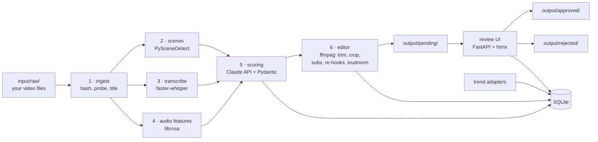

# clipforge

**Local pipeline that turns long-form video you own into short vertical clips: shot detection, word-level transcription, audio analysis, LLM scoring, and an ffmpeg editor — with a mobile-friendly human review step at the end.**


Developed in September 2026.

## Overview

clipforge takes long movie files and produces short 9:16 clips optimised for retention,
scores them with the Anthropic Claude API, and hands them to you in a review UI. **You supply
the video files and you do the uploading** — clipforge only does the middle part. You are
responsible for having the rights to the material you process.

**Out of scope, by design:** no video downloading or scraping, no publishing to any platform,
no multi-account management. Input comes from `input/raw/`; output stops at `output/approved/`.

## Key features

- **Shot-aware segmentation** (PySceneDetect) — a segment boundary is always a shot
  boundary; the pipeline never cuts mid-shot.
- **Word-level transcription** (faster-whisper with `word_timestamps=True`) driving both the
  subtitles and the dead-air trimmer.
- **Audio features** — per-second RMS, silence ratio, onset rate, energy delta and detected
  dramatic peaks (librosa).
- **LLM scoring with structured output** — each candidate is scored on six weighted axes
  (hook strength, emotional peak, standalone clarity, quotability, visual interest, ability
  to sustain 3 minutes); responses are validated with Pydantic and retried with exponential
  backoff. An *iconic-scene* map of the film reorders the work so `--top N` scores the
  promising zones first, and **every verdict is persisted** so weights can be re-tuned
  without paying for the API again.
- **ffmpeg editor via subprocess** — dead-air trimming with a single re-timing map, a 1.5 s
  cold open, dynamic 9:16 crop that follows faces (OpenCV) or motion, burned-in ASS subtitles
  with per-word highlight inside a safe zone, re-hooks snapped to audio peaks, loudnorm to
  −14 LUFS, and a thumbnail. Each clip ships with a JSON of the exact variants applied.
- **Review UI** (FastAPI + Jinja2 + htmx) reachable from a phone on the LAN, with keyboard
  shortcuts, caption editing, rejection reasons and approval stats.
- **Trend detector** with pluggable, fail-soft adapters (manual CSV, anniversaries, Google
  Trends, LLM seeding, and optional community sources).
- **Safe source cleanup** — originals are deleted only after every clip rendered without a
  single error, with `--dry-run` and `--keep-source`.
- **Idempotent and cached** — files are keyed by hash; scenes, transcripts and audio features
  are cached; everything is recorded in SQLite.

## Architecture



The editor's order of operations (`clipforge/edit.py`):

1. dead-air trim — silences over 400 ms removed, 150 ms of breath kept, with a re-timing map
   so subtitles and re-hooks keep landing on the right frames;
2. cold open — 1.5 s taken from the peak-tension frame with the hook text over it;
3. dynamic 9:16 crop with smoothing and speaker alternation;
4. burned-in subtitles inside the safe zone;
5. re-hooks — alternating incoming text and 3-5 % zoom punches snapped to audio peaks;
6. audio — loudnorm to −14 LUFS, aggressive compression, dialogue lift;
7. ending — cut before the resolution, or a continuity line;
8. thumbnail.

## Getting started

### Requirements

- Python 3.11 or 3.12 (3.13+ is not supported yet by faster-whisper/librosa wheels)
- [uv](https://docs.astral.sh/uv/)
- `ffmpeg` and `ffprobe` on your `PATH`

Install ffmpeg:

```bash
# Arch
sudo pacman -S ffmpeg
# Debian/Ubuntu
sudo apt install ffmpeg
# macOS
brew install ffmpeg
```

Install uv:

```bash
curl -LsSf https://astral.sh/uv/install.sh | sh
```

### Setup

```bash
make setup                      # uv venv + editable install + folder tree
cp .env.example .env            # then put your real key in it
```

`ANTHROPIC_API_KEY` is required for the scoring stage (`clipforge analyze`) and for the
`seed_llm` trend source. If yours is an identity-linked key, also set `ANTHROPIC_WORKSPACE_ID`
— the API rejects those keys with a 400 naming the missing workspace header. Everything else
runs offline.

### End-to-end example

```bash
# 1. Drop a long video into the input folder
cp ~/Videos/Heat.1995.1080p.BluRay.x264.mkv input/raw/

# 2. Register it (idempotent — already-known files are skipped unless --force)
uv run clipforge scan
#  id  title  duration  resolution
#   1  Heat   2:50:12   1920x1080

# 3. Scenes + transcription + audio features + scoring
uv run clipforge analyze 1

# 4. Render the 6 best candidates into vertical clips
uv run clipforge render 1 --top 6
#  -> output/pending/<clip_id>.mp4 + <clip_id>.json

# Or do all of it, plus source cleanup, in one shot:
uv run clipforge run 1 --top 6 --dry-run     # shows what it would delete
uv run clipforge run 1 --top 6               # deletes input/raw/Heat...mkv on full success
uv run clipforge run 1 --top 6 --keep-source # never deletes

# 5. Review (phase 2) — open from your phone at http://<local-ip>:8000
uv run clipforge review

# 6. Trend signals (phase 3)
uv run clipforge trends --refresh
uv run clipforge stats
```

### Configuration

Everything lives in `config.yaml`: scene thresholds, target durations, scoring weights,
subtitle style and safe zone, Whisper model, number of re-hooks, audio compression
aggressiveness, and the source-deletion policy. Defaults are defined in `clipforge/config.py`
and the YAML file deep-merges on top, so a partial config is always valid.

Point at a different file with `--config path/to.yaml` or `CLIPFORGE_CONFIG=...`.

## Review UI

`uv run clipforge review` serves on `0.0.0.0:8000` and prints both URLs, including the LAN one
so you can review the verticals on your phone.
The UI has no authentication: run it only on a trusted network.

Keyboard: `A` approve · `R` reject (then `1`-`5` for the reason) · `E` edit the caption
(`Ctrl`/`Cmd`+`Enter` approves from the textarea) · `←` `→` navigate · `space` play/pause.

Approved clips move to `output/approved/` with the final caption in their JSON; rejected ones
move to `output/rejected/` with the reason. `uv run clipforge stats` (or `/stats` in the UI)
shows the approval rate, rejection reasons and average scores.

## Daily routine — two commands

```bash
uv run clipforge daily      # refresh trends, queue titles, process new videos, report
uv run clipforge review     # approve or reject the clips it produced
```

`daily` is the whole round in one command, and it is safe to run every day:

1. Refreshes every enabled trend source.
2. Auto-marks the best `daily.auto_queue` titles (default 3) as **pendiente de descargar**,
   skipping anything already processed, queued or ignored — so it tops the queue up instead
   of re-marking the same films.
3. Scans `input/raw/` and processes every new video end to end (analyze + render `--top 6`).
   A video that fails is recorded and the rest continue.
4. Prints what to download and how many clips are waiting for review.

It never deletes source files until you set `daily.keep_source: false` (or pass
`--delete-source`). `--dry-run` reports what it would do and changes nothing; `--skip-refresh`
reuses the stored signals instead of querying anything.

Your part of the loop stays manual by design: `daily` tells you which films to get, you get
them and drop them in `input/raw/`, and the next `daily` turns them into clips.

## Trend detector

Every source is an optional adapter; if one is disabled, missing a dependency or broken, the
run carries on without it.

| source | what it measures | default |
|---|---|---|
| `manual_csv` | titles you write by hand | on |
| `seed_llm` | the Claude API proposes candidate films with a reason, once a month | on |
| `anniversaries` | 10/20/25/30 years from release, ±30 days | on |
| `pytrends` | Google Trends slope over 7 days, `geo=ES` | on |
| `reddit` | r/movies + r/NetflixBestOf weekly top | off |
| `letterboxd` | popular this week | off |
| `justwatch` | arrival dates on Spanish catalogues | off |
| `tiktok_cc` | trending hashtags (context, not films) | off |

The three that depend on undocumented endpoints ship **off**; enable them in `config.yaml`
under `trends.sources` if you want them.

```
input/manual/trending.csv        title,year,slope,saturation,note   (only `title` is required)
input/manual/release_dates.csv   title,year,release_date,country    (300 films ship with the repo)
```

```bash
uv run clipforge trends --refresh          # query the enabled sources and rank
uv run clipforge trends --source reddit    # refresh one adapter, keeping the others' readings
uv run clipforge queue                     # the titles marked "pendiente de descargar"
```

Ranking: `score = trend_slope × (1 / saturation) × iconic_scene_density`. The slope is what
counts — a film climbing 20 → 45 outranks one flat at 80. Saturation comes from the source or
your CSV, and is otherwise estimated from how many sources are already shouting about it.
Iconic density reuses the scoring module's cached scene map, so it costs no API calls.

**How the sources feed each other**: `seed_llm` proposes new titles once a month, and they
enter with a fixed mid-table slope — its own confidence is never trusted as a score. On the
next refresh `pytrends` measures those titles for real and `anniversaries` adds any round
date, so a seeded film is ranked by measurement rather than by the model's opinion.

The dashboard lives at `/trends` in the same app: sortable table, a button to mark a title as
"pendiente de descargar", and films already in the database are greyed out as processed so
they never get queued twice.

## Development

```bash
make test    # pytest
make lint    # ruff
make fmt     # ruff --fix + format
```

## Project layout

```
clipforge/          the package: cli, ingest, scenes, transcribe, audio_features,
                    scoring, crop, subtitles, retiming, edit, cleanup, trends, daily,
                    review (+ web/ templates and static), adapters/ (trend sources)
tests/              pytest suite
config.yaml         every tunable value
input/raw/          videos you drop in (deleted after a fully successful render)
input/manual/       manual CSVs for the trend detector
output/pending/     rendered clips awaiting review
output/approved/    approved clips + final caption JSON  <- your upload queue
output/rejected/    rejected clips + reason
data/clipforge.db   SQLite: videos, segments, every score, errors, deletions
data/cache/         transcripts, scene lists, audio features (keyed by file hash)
```

## Status

- Phase 1 — engine (modules 1-6): done
- Phase 2 — review UI: done
- Phase 3 — trend detector + dashboard: done

## Tech stack

Python 3.11/3.12 · Typer + Rich (CLI) · PySceneDetect · faster-whisper · librosa · NumPy ·
OpenCV · Anthropic Python SDK · Pydantic · SQLModel/SQLite · FastAPI · Uvicorn · Jinja2 ·
htmx · httpx · pytrends · ffmpeg · uv · pytest · ruff

## License

[MIT](LICENSE) © 2026 Gabriel Huertas
